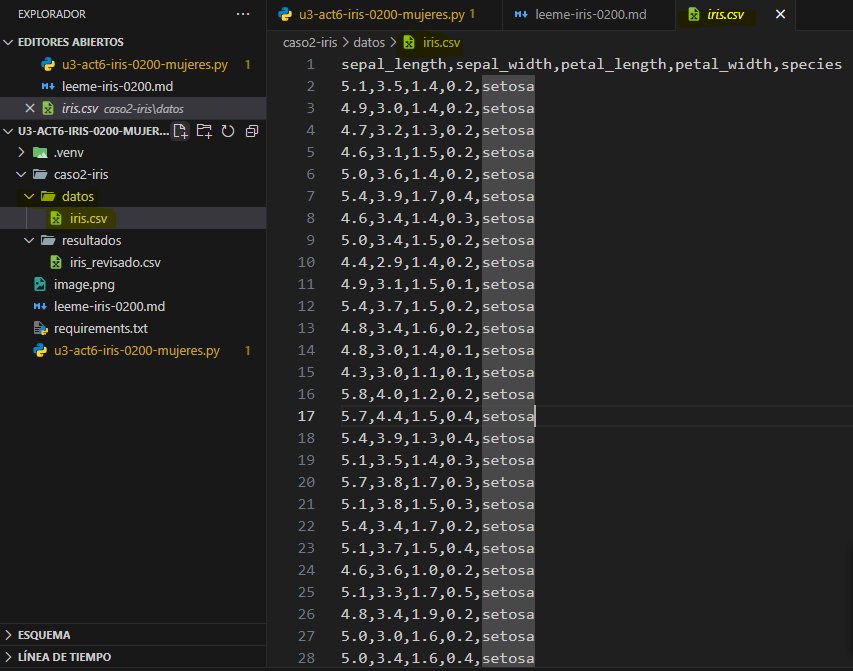
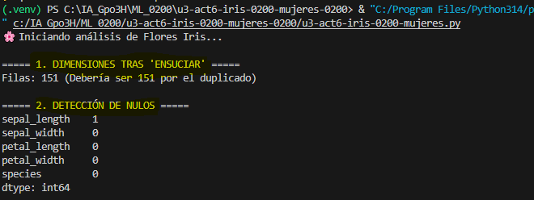
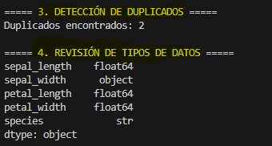
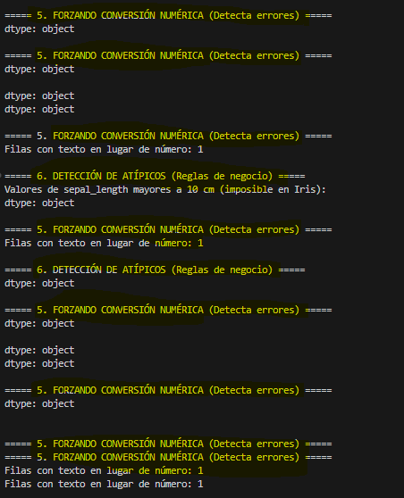
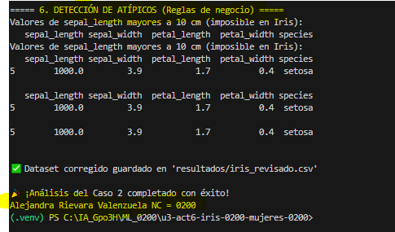

# 🕵️‍♂️ Práctica: Identificación de Problemas en los Datos
# 𝑨𝒍𝒆𝒋𝒂𝒏𝒅𝒓𝒂 𝑹𝒊𝒗𝒆𝒓𝒂 𝑽𝒂𝒍𝒆𝒏𝒛𝒖𝒆𝒍𝒂 𝑵𝑪 = 𝟎𝟐𝟎𝟎
> **⏱️ Duración:** 2 horas  
> **🎯 Nivel:** Cero a principiante  
> **🤖 Área:** Machine Learning (Data Cleaning)  
> **💻 Herramientas:** Python, VS Code, Pandas, NumPy, Seaborn 
## 🎯 Propósito de la Práctica
Que los estudiantes aprendan a revisar conjuntos de datos (*datasets*) e identifiquen los problemas más comunes que pueden arruinar el entrenamiento de un modelo de Machine Learning. 

Trabajaremos con dos escenarios reales:
# 2. **Caso 2: Flores Iris** 🌸 (Detección de problemas simulados para aprender a depurar).
 
# 𝑫𝒂𝒕𝒐𝒔 0200

# 𝑹𝒆𝒔𝒖𝒍𝒕𝒂𝒅𝒐 0200

# 𝑫𝑰𝑴𝑬𝑵𝑺𝑰𝑶𝑵𝑬𝑺 𝑻𝑹𝑨𝑺 '𝑬𝑵𝑺𝑼𝑪𝑰𝑨𝑹' 0200

# 𝑫𝑬𝑻𝑬𝑪𝑪𝑰𝑶𝑵 𝑫𝑬 𝑫𝑼𝑷𝑳𝑰𝑪𝑨𝑫𝑶𝑺 𝒀 𝑹𝑬𝑽𝑰𝑺𝑰𝑶𝑵 𝑫𝑬 𝑻𝑰𝑷𝑶𝑺 𝑫𝑬 𝑫𝑨𝑻𝑶𝑺 0200

# 𝑭𝑶𝑹𝒁𝑨𝑵𝑫𝑶 𝑪𝑶𝑵𝑽𝑬𝑹𝑺𝑰𝑶𝑵 𝑵𝑼𝑴𝑬𝑹𝑰𝑪𝑨 (𝑫𝒆𝒕𝒆𝒄𝒕𝒂 𝒆𝒓𝒓𝒐𝒓𝒆𝒔) 𝟎𝟐𝟎𝟎 

# 𝟔. 𝑫𝑬𝑻𝑬𝑪𝑪𝑰𝑶𝑵 𝑫𝑬 𝑨𝑻𝑰𝑷𝑰𝑪𝑶𝑺 (𝑹𝒆𝒈𝒍𝒂𝒔 𝒅𝒆 𝒏𝒆𝒈𝒐𝒄𝒊𝒐) 𝟎𝟐𝟎𝟎
